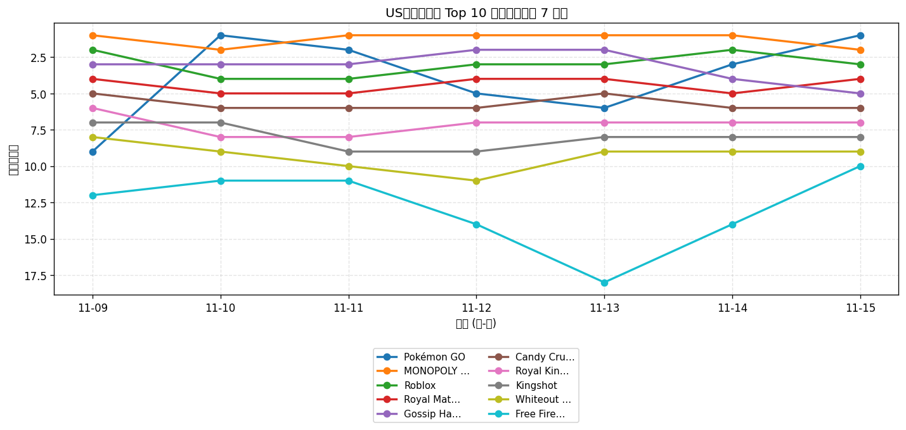
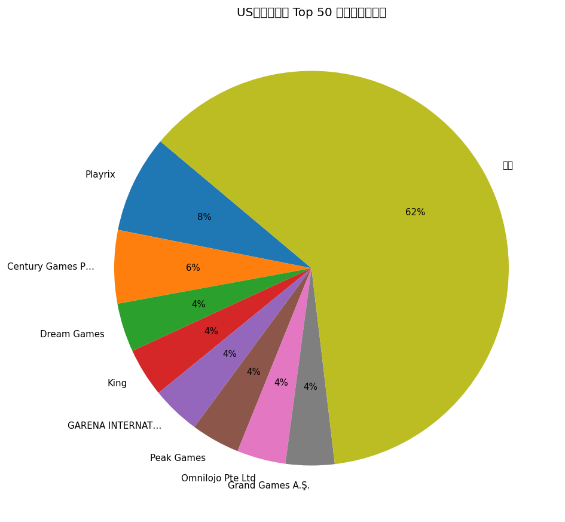
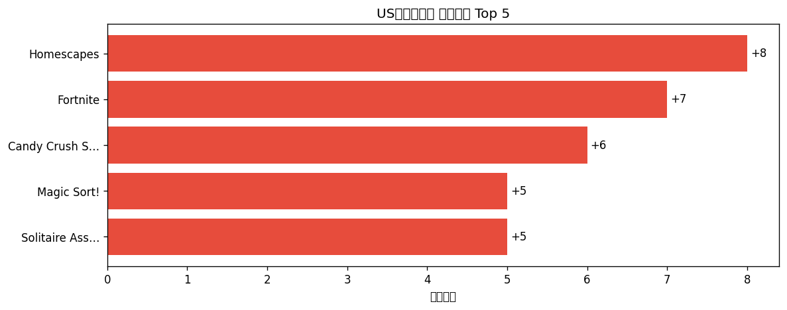

# 📊 游戏榜单日报 - 2026-11-15

**市场**：US　**榜单**：畅销游戏榜

## 📈 Top 10 排名趋势（近 7 天）

## 🏢 开发者席位占比

## 今日 Top 50

| 游戏榜排名 | 总榜排名 | 应用名称 | 开发者 |
| --- | --- | --- | --- |
| 1 | 4 | Pokémon GO | Scopely Explore, Inc. |
| 2 | 7 | MONOPOLY GO! | Scopely, Inc. |
| 3 | 9 | Roblox | Roblox Corporation |
| 4 | 11 | Royal Match | Dream Games |
| 5 | 13 | Gossip Harbor®: Merge & Story | Microfun Limited |
| 6 | 15 | Candy Crush Saga | King |
| 7 | 22 | Royal Kingdom | Dream Games |
| 8 | 28 | Kingshot | Century Games Pte. Ltd. |
| 9 | 31 | Whiteout Survival | Century Games Pte. Ltd. |
| 10 | 37 | Free Fire x NARUTO SHIPPUDEN | GARENA INTERNATIONAL I PRIVATE LIMITED |
| 11 | 40 | Total Battle: War Strategy | Scorewarrior |
| 12 | 44 | Toon Blast | Peak Games |
| 13 | 46 | Township | Playrix |
| 14 | 49 | Call of Duty®: Mobile | Activision Publishing, Inc. |
| 15 | 52 | Match Factory! | Peak Games |
| 16 | 53 | Gardenscapes | Playrix |
| 17 | 55 | Colony Flow! | ABI GLOBAL LTD. |
| 18 | 56 | Tasty Travels: Merge Game | Century Games Pte. Ltd. |
| 19 | 57 | Last Z: Survival Shooter | Omnilojo Pte Ltd |
| 20 | 60 | Homescapes | Playrix |
| 21 | 61 | Pixel Flow! | Loom Games Oyun Yazilim ve Pazarlama Anonim Sirketi |
| 22 | 62 | Last War:Survival | FUNFLY PTE. LTD. |
| 23 | 63 | Block Out! - Color Sort Puzzle | Grand Games A.Ş. |
| 24 | 64 | Fishdom | Playrix |
| 25 | 65 | Coin Master | Moon Active |
| 26 | 66 | Evony | TOP GAMES INC. |
| 27 | 69 | Magic Sort! | Grand Games A.Ş. |
| 28 | 70 | Bus Traffic Fever! | GOODROID,Inc. |
| 29 | 72 | Disney Solitaire | SuperPlay |
| 30 | 75 | EA SPORTS FC Soccer Mobile 27 | Electronic Arts |
| 31 | 83 | Lightning Link Casino Slots | Product Madness |
| 32 | 84 | Jackpot Party - Casino Slots | Phantom EFX, Inc. |
| 33 | 85 | Screwdom | Zego Global Pte Ltd |
| 34 | 87 | Jelly Busters: Puzzle Game | Moon Active |
| 35 | 89 | Clash of Clans | Supercell |
| 36 | 94 | Fortnite | Epic Games Inc. |
| 37 | 96 | Yarn Loop: Knit Puzzle | Combo Games |
| 38 | 99 | Merge Cooking® | Happibits |
| 39 | - | Cashman Casino Slots Games | Product Madness |
| 40 | - | Solitaire Associations Journey | Hitapps Games LTD |
| 41 | - | PUBG MOBILE | Tencent Mobile International Limited |
| 42 | - | Candy Crush Soda Saga | King |
| 43 | - | All in Hole: Black Hole Games | HOMA GAMES |
| 44 | - | Sand Blocks: Drop Puzzle | Rollic Games |
| 45 | - | eFootball™ | KONAMI |
| 46 | - | Free Fire MAX x NARUTO | GARENA INTERNATIONAL I PRIVATE LIMITED |
| 47 | - | Dice Dreams™ | SuperPlay |
| 48 | - | Dark War:Survival | Omnilojo Pte Ltd |
| 49 | - | Honkai: Star Rail | COGNOSPHERE PTE. LTD. |
| 50 | - | Pokémon TCG Pocket | The Pokemon Company |

## 🔥 上升最快 Top 5

| 应用名称 | 游戏榜变化 | 今日游戏榜排名 |
| --- | --- | --- |
| Homescapes | ↑8 (#28→#20) | #20 |
| Fortnite | ↑7 (#43→#36) | #36 |
| Candy Crush Soda Saga | ↑6 (#48→#42) | #42 |
| Magic Sort! | ↑5 (#32→#27) | #27 |
| Solitaire Associations Journey | ↑5 (#45→#40) | #40 |

## 🆕 新入榜 Top 5

| 应用名称 | 游戏榜排名 | 总榜排名 | 开发者 |
| --- | --- | --- | --- |
| All in Hole: Black Hole Games | #43 | - | HOMA GAMES |
| Free Fire MAX x NARUTO | #46 | - | GARENA INTERNATIONAL I PRIVATE LIMITED |

## 📝 运营小结

今日US畅销游戏榜游戏榜由「Pokémon GO」领跑（总榜 #4），「Homescapes」游戏榜上升 8 位（#28 → #20），值得关注；新入榜游戏包括 All in Hole: Black Hole Games、Free Fire MAX x NARUTO 等，建议持续跟踪后续表现。
