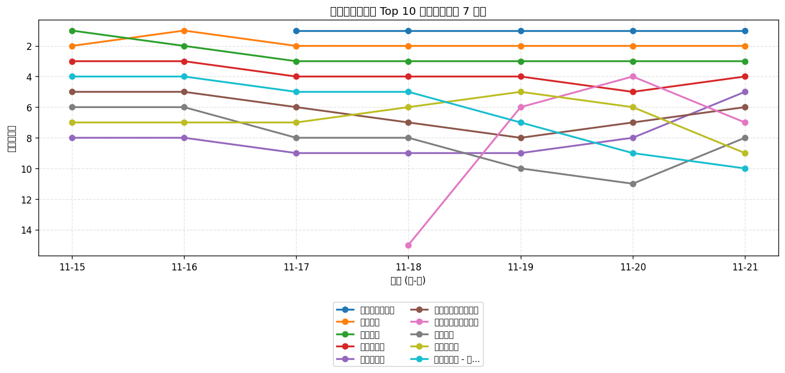
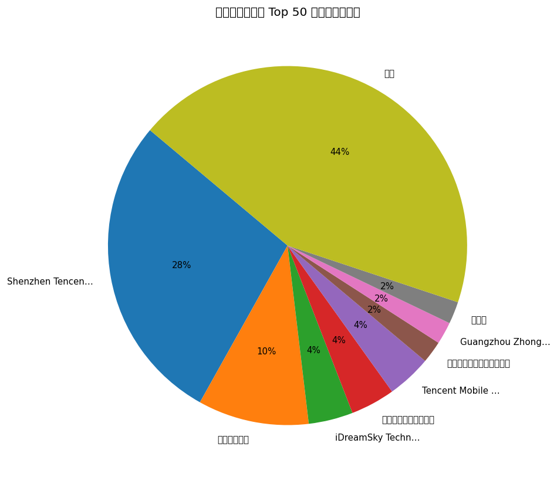
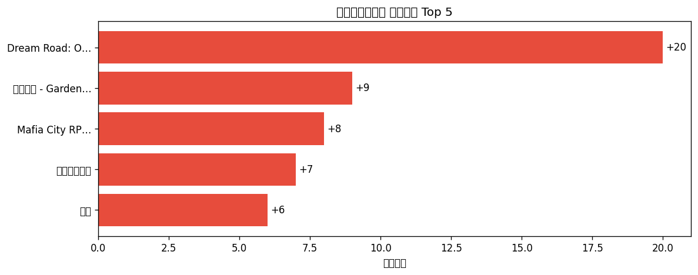

# 📊 游戏榜单日报 - 2026-11-21

**市场**：中国　**榜单**：免费游戏榜

## 📈 Top 10 排名趋势（近 7 天）

## 🏢 开发者席位占比

## 今日 Top 50

| 游戏榜排名 | 总榜排名 | 应用名称 | 开发者 |
| --- | --- | --- | --- |
| 1 | - | 我在古代有座城 | 安徽盈趣网络科技有限公司 |
| 2 | - | 王者荣耀 | Shenzhen Tencent Tianyou Technology Ltd |
| 3 | - | 和平精英 | Shenzhen Tencent Tianyou Technology Ltd |
| 4 | - | 三角洲行动 | Shenzhen Tencent Tianyou Technology Ltd |
| 5 | - | 王者万象棋 | Shenzhen Tencent Tianyou Technology Ltd |
| 6 | - | 无畏契约：源能行动 | Shenzhen Tencent Tianyou Technology Ltd |
| 7 | - | 斗罗大陆：诛邪传说 | Guangzhou Zhongxu Shuke Information Technology Co., Ltd |
| 8 | - | 蛋仔派对 | 网易移动游戏 |
| 9 | - | 开心消消乐 | 乐元素 |
| 10 | - | 超级整理师 - 找一找隐藏的物品 | AkerSun Technology Co.,Ltd. |
| 11 | - | 无尽宝藏 | Moli Games |
| 12 | - | 我的世界：移动版 | 网易移动游戏(MC) |
| 13 | - | 地铁跑酷 - 时光十三载热爱一直在 | iDreamSky Technology Limited |
| 14 | - | 腾讯欢乐斗地主 | Shenzhen Tencent Tianyou Technology Ltd |
| 15 | - | 金铲铲之战 | Shenzhen Tencent Tianyou Technology Ltd |
| 16 | - | 疯狂水世界 | 益世界网络科技(上海)有限公司 |
| 17 | - | 迷你世界 | Miniwan Tech |
| 18 | - | 火影忍者 | Shenzhen Tencent Tianyou Technology Ltd |
| 19 | - | 英雄联盟手游 | Shenzhen Tencent Tianyou Technology Ltd |
| 20 | - | 贪吃蛇大作战® | Wuhan Weipai Network Technology Co., Ltd. |
| 21 | - | Dream Road: Online | Bellum Games LLC |
| 22 | - | 部落冲突（Clash of Clans） | Shenzhen Tencent Tianyou Technology Ltd |
| 23 | - | 植物大战僵尸2 | PopCap |
| 24 | - | 穿越火线-枪战王者 | Shenzhen Tencent Tianyou Technology Ltd |
| 25 | - | QQ飞车 | Shenzhen Tencent Tianyou Technology Ltd |
| 26 | - | 燕云十六声 | 网易移动游戏 |
| 27 | - | 超自然行动组 | 巨人网络科技有限公司 |
| 28 | - | GTA 5 Mobile Multiplayer 2022 | Mehmet Ugurlu |
| 29 | - | 向末日开炮 | Dod Joy Co., Ltd. |
| 30 | - | 飞机大厨：空中烹饪 | Nordcurrent UAB |
| 31 | - | 第五人格 | 网易移动游戏 |
| 32 | - | 光·遇 | 网易移动游戏 |
| 33 | - | 羊了个羊：星球 | Beijing Jianyou Technology Co., Ltd. |
| 34 | - | 美职篮巅峰对决 | Gala Sports Technology Limited |
| 35 | - | 欢乐麻将 | Tencent Mobile Games |
| 36 | - | 开放世界游戏grand黑帮黑手党罪恶都市 | Muhammad Tayyab Rafique Muhammad Rafique |
| 37 | - | Mafia City RP:Grand Open World | Ngoc vinh trading service company limited |
| 38 | - | 神庙逃亡2 | iDreamSky Technology Limited |
| 39 | - | 梦幻花园 - Gardenscapes | Beijing Wei Wo Le Yuan Information and Technology Co., Ltd |
| 40 | - | 原神 | miHoYo Games |
| 41 | - | 暗区突围 | Shenzhen Tencent Tianyou Technology Ltd |
| 42 | - | 汤姆猫跑酷-猫拉松：传奇冒险 | Outfit7 Limited |
| 43 | - | 途游斗地主（比赛版） | Tuyoo Online HK Limited |
| 44 | - | 巅峰极速 | 网易移动游戏 |
| 45 | - | 使命召唤手游 | Shenzhen Tencent Tianyou Technology Ltd |
| 46 | - | 天天爱数独-这关我不会数独大师 | 贺涛 周 |
| 47 | - | 球球大作战-无条件送超大 | 巨人网络科技有限公司 |
| 48 | - | 黄油猫 | Team Woll |
| 49 | - | 天天酷跑 | Tencent Mobile Games |
| 50 | - | 时尚百货城 | 深圳市爱的番茄科技有限公司 |

## 🔥 上升最快 Top 5

| 应用名称 | 游戏榜变化 | 今日游戏榜排名 |
| --- | --- | --- |
| Dream Road: Online | ↑20 (#41→#21) | #21 |
| 梦幻花园 - Gardenscapes | ↑9 (#48→#39) | #39 |
| Mafia City RP:Grand Open World | ↑8 (#45→#37) | #37 |
| 超自然行动组 | ↑7 (#34→#27) | #27 |
| 原神 | ↑6 (#46→#40) | #40 |

## 🆕 新入榜 Top 5

| 应用名称 | 游戏榜排名 | 总榜排名 | 开发者 |
| --- | --- | --- | --- |
| 暗区突围 | #41 | - | Shenzhen Tencent Tianyou Technology Ltd |
| 使命召唤手游 | #45 | - | Shenzhen Tencent Tianyou Technology Ltd |
| 天天爱数独-这关我不会数独大师 | #46 | - | 贺涛 周 |
| 黄油猫 | #48 | - | Team Woll |

## 📝 运营小结

今日中国免费游戏榜游戏榜由「我在古代有座城」领跑（总榜 #-），「Dream Road: Online」游戏榜上升 20 位（#41 → #21），值得关注；新入榜游戏包括 暗区突围、使命召唤手游、天天爱数独-这关我不会数独大师 等，建议持续跟踪后续表现。
