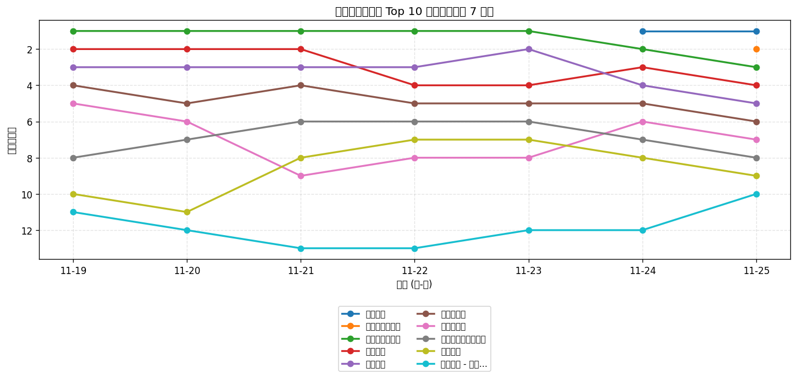
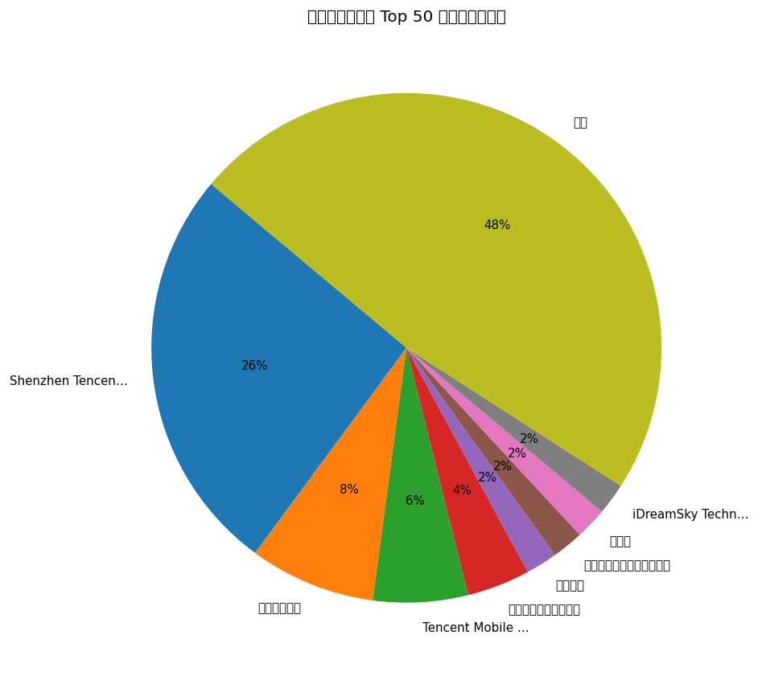
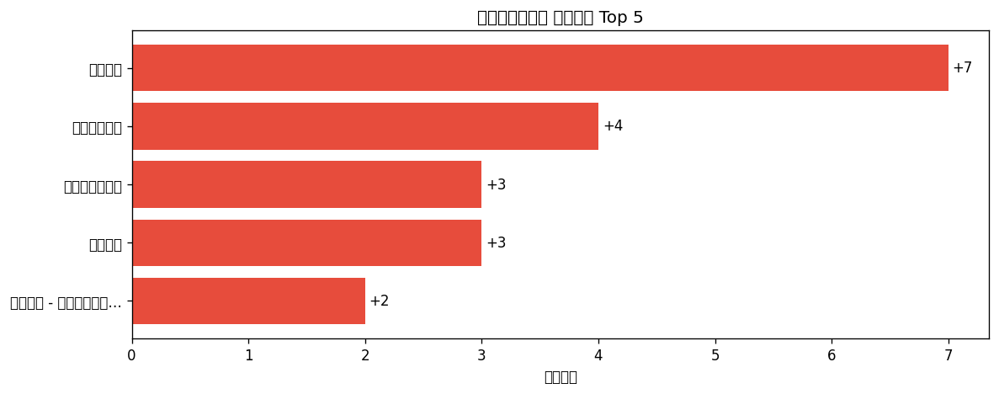

# 📊 游戏榜单日报 - 2026-11-25

**市场**：中国　**榜单**：免费游戏榜

## 📈 Top 10 排名趋势（近 7 天）

## 🏢 开发者席位占比

## 今日 Top 50

| 游戏榜排名 | 总榜排名 | 应用名称 | 开发者 |
| --- | --- | --- | --- |
| 1 | - | 饥困荒野 | Shenzhen Tencent Tianyou Technology Ltd |
| 2 | - | 蓝色星原：旅谣 | 蛮啾游戏 |
| 3 | - | 我在古代有座城 | 安徽盈趣网络科技有限公司 |
| 4 | - | 王者荣耀 | Shenzhen Tencent Tianyou Technology Ltd |
| 5 | - | 和平精英 | Shenzhen Tencent Tianyou Technology Ltd |
| 6 | - | 三角洲行动 | Shenzhen Tencent Tianyou Technology Ltd |
| 7 | - | 开心消消乐 | 乐元素 |
| 8 | - | 无畏契约：源能行动 | Shenzhen Tencent Tianyou Technology Ltd |
| 9 | - | 蛋仔派对 | 网易移动游戏 |
| 10 | - | 地铁跑酷 - 时光十三载热爱一直在 | iDreamSky Technology Limited |
| 11 | - | 腾讯欢乐斗地主 | Shenzhen Tencent Tianyou Technology Ltd |
| 12 | - | 超级整理师 - 找一找隐藏的物品 | AkerSun Technology Co.,Ltd. |
| 13 | - | 金铲铲之战 | Shenzhen Tencent Tianyou Technology Ltd |
| 14 | - | 火影忍者 | Shenzhen Tencent Tianyou Technology Ltd |
| 15 | - | 王者万象棋 | Shenzhen Tencent Tianyou Technology Ltd |
| 16 | - | 我的世界：移动版 | 网易移动游戏(MC) |
| 17 | - | 土豆兄弟(Brotato) | 杭州星帆广告传媒有限公司 |
| 18 | - | 英雄联盟手游 | Shenzhen Tencent Tianyou Technology Ltd |
| 19 | - | 疯狂水世界 | 益世界网络科技(上海)有限公司 |
| 20 | - | 灵宝派对 | Xiaoshu Technology Limited |
| 21 | - | 炽武之巅 | Hongdong Jushengdeng Network Technology Co., Ltd. |
| 22 | - | 贪吃蛇大作战® | Wuhan Weipai Network Technology Co., Ltd. |
| 23 | - | 黄油猫 | Team Woll |
| 24 | - | 迷你世界 | Miniwan Tech |
| 25 | - | 植物大战僵尸2-联机加好友 | PopCap |
| 26 | - | 部落冲突（Clash of Clans） | Shenzhen Tencent Tianyou Technology Ltd |
| 27 | - | 穿越火线-枪战王者 | Shenzhen Tencent Tianyou Technology Ltd |
| 28 | - | QQ飞车 | Shenzhen Tencent Tianyou Technology Ltd |
| 29 | - | Tool Toss: Spinning Target | Zaira Jane Ceballos |
| 30 | - | Dream Road: Online | Bellum Games LLC |
| 31 | - | 燕云十六声 | 网易移动游戏 |
| 32 | - | 幻梦无年 | 707 INTERACTIVE |
| 33 | - | 地下城与勇士：起源 | Tencent Mobile Games |
| 34 | - | 飞机大厨：空中烹饪 | Nordcurrent UAB |
| 35 | - | 羊了个羊：星球 | Beijing Jianyou Technology Co., Ltd. |
| 36 | - | 欢乐麻将 | Tencent Mobile Games |
| 37 | - | 美职篮巅峰对决 | Gala Sports Technology Limited |
| 38 | - | 挨饿荒野 | Shaoxing Kuaifei Network Technology Co., Ltd |
| 39 | - | 向末日开炮 | Dod Joy Co., Ltd. |
| 40 | - | 第五人格 | 网易移动游戏 |
| 41 | - | 搬砖达人:无限乐趣 | 学源 庞 |
| 42 | - | 超自然行动组 | 巨人网络科技有限公司 |
| 43 | - | 光·遇 | 网易移动游戏 |
| 44 | - | 途游斗地主（比赛版） | Tuyoo Online HK Limited |
| 45 | - | 开放世界游戏grand黑帮黑手党罪恶都市 | Muhammad Tayyab Rafique Muhammad Rafique |
| 46 | - | 球球大作战-送专属定制嘉年华 | 巨人网络科技有限公司 |
| 47 | - | honeybearsue | Paola Zamrana |
| 48 | - | 天天酷跑 | Tencent Mobile Games |
| 49 | - | 斗罗大陆：诛邪传说 | Guangzhou Zhongxu Shuke Information Technology Co., Ltd |
| 50 | - | 梦幻花园 - Gardenscapes | Beijing Wei Wo Le Yuan Information and Technology Co., Ltd |

## 🔥 上升最快 Top 5

| 应用名称 | 游戏榜变化 | 今日游戏榜排名 |
| --- | --- | --- |
| 炽武之巅 | ↑7 (#28→#21) | #21 |
| 英雄联盟手游 | ↑4 (#22→#18) | #18 |
| 腾讯欢乐斗地主 | ↑3 (#14→#11) | #11 |
| 火影忍者 | ↑3 (#17→#14) | #14 |
| 地铁跑酷 - 时光十三载热爱一直在 | ↑2 (#12→#10) | #10 |

## 🆕 新入榜 Top 5

| 应用名称 | 游戏榜排名 | 总榜排名 | 开发者 |
| --- | --- | --- | --- |
| 蓝色星原：旅谣 | #2 | - | 蛮啾游戏 |
| 灵宝派对 | #20 | - | Xiaoshu Technology Limited |
| Tool Toss: Spinning Target | #29 | - | Zaira Jane Ceballos |
| 幻梦无年 | #32 | - | 707 INTERACTIVE |
| 地下城与勇士：起源 | #33 | - | Tencent Mobile Games |

## 📝 运营小结

今日中国免费游戏榜游戏榜由「饥困荒野」领跑（总榜 #-），「炽武之巅」游戏榜上升 7 位（#28 → #21），值得关注；新入榜游戏包括 蓝色星原：旅谣、灵宝派对、Tool Toss: Spinning Target 等，建议持续跟踪后续表现。
